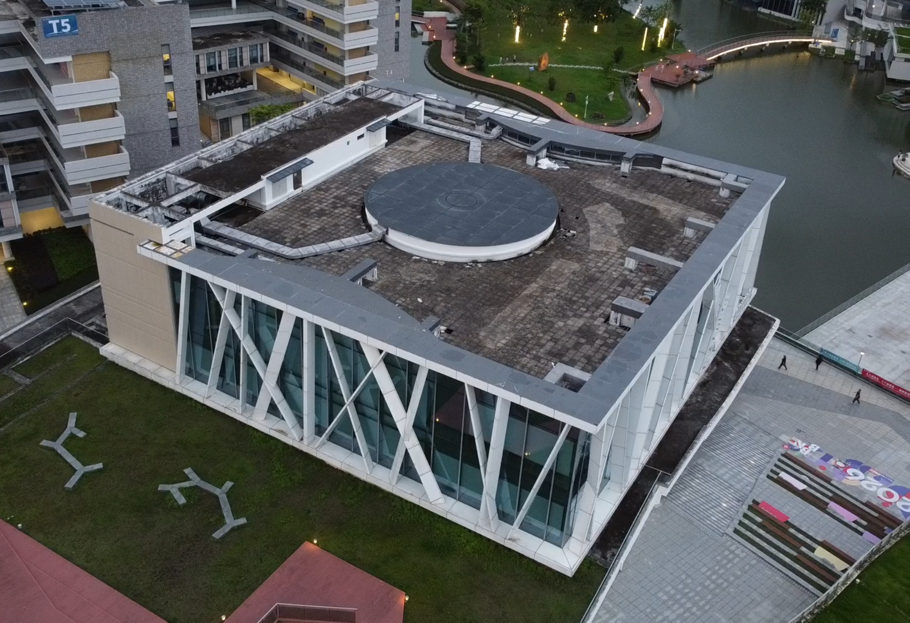
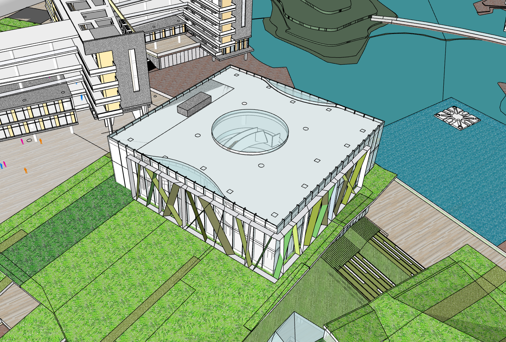
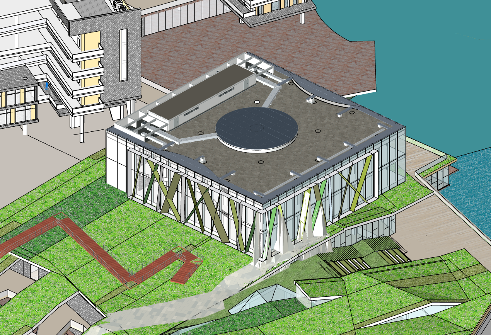
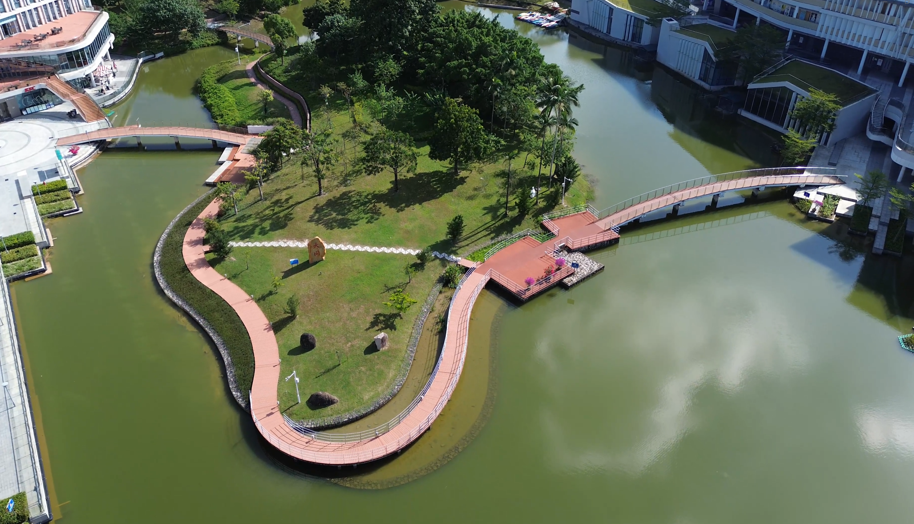
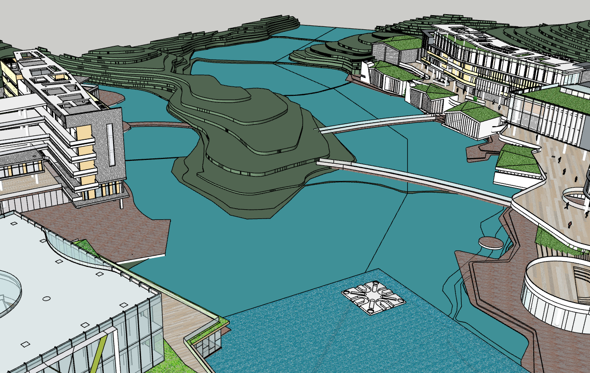
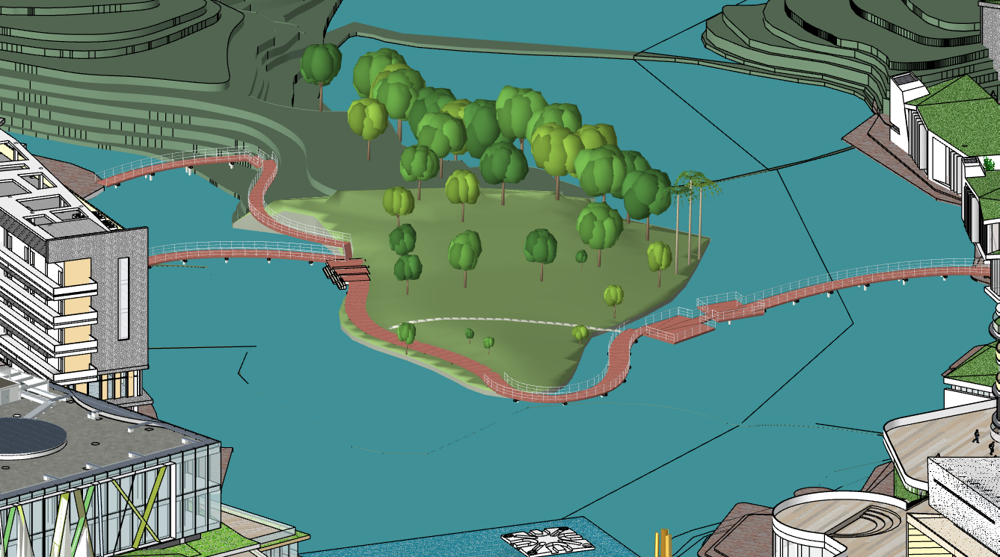
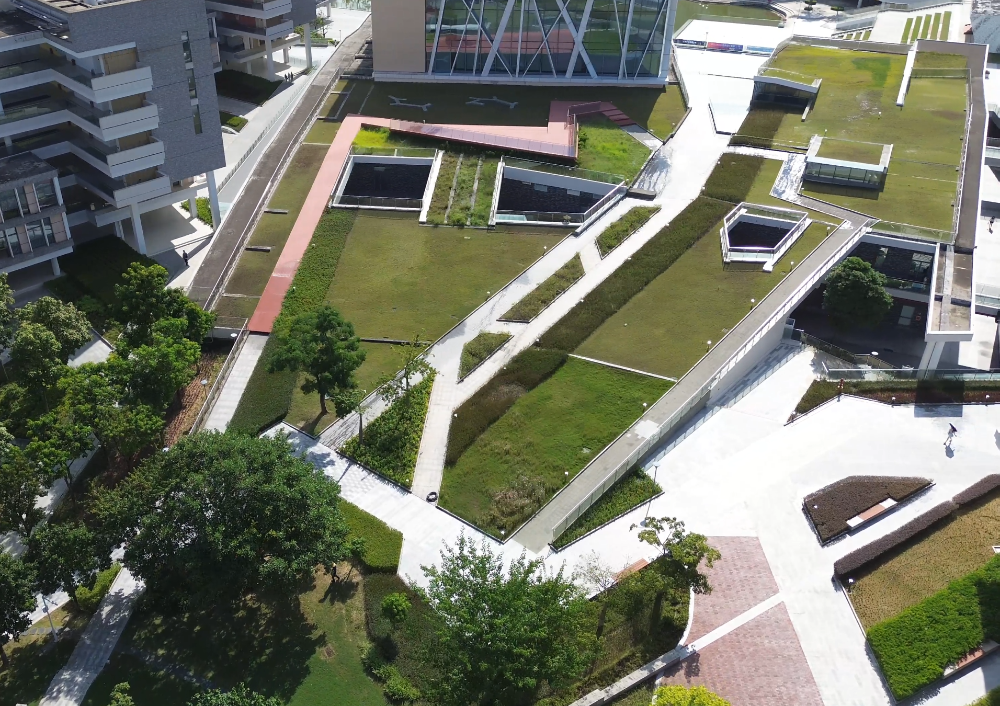
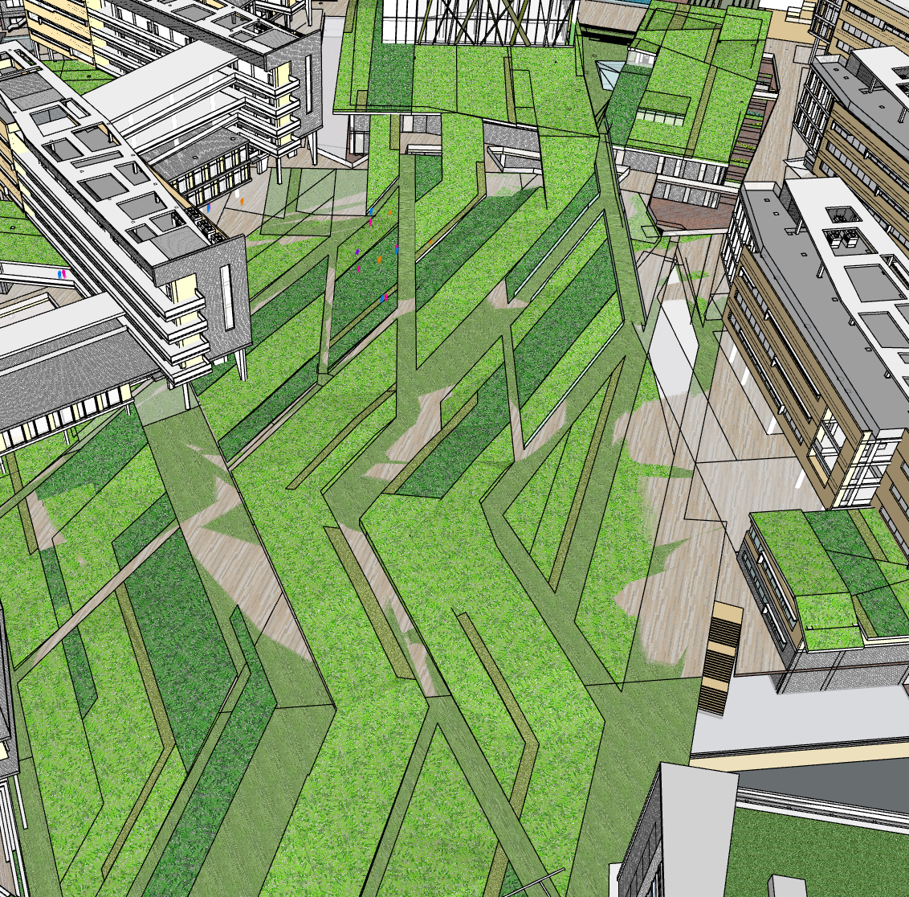
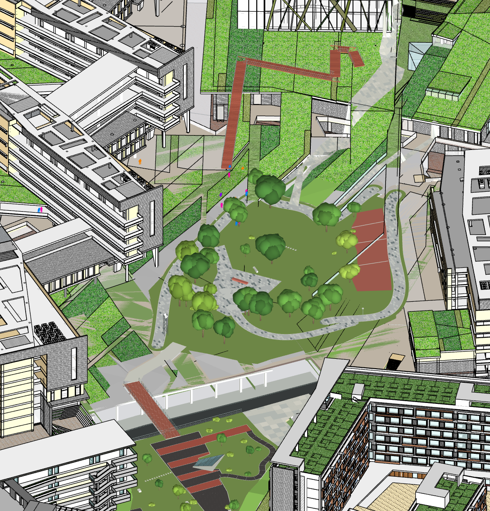

# Zip2CAD 1.0 · ZipMap反向修正CAD图纸

从实景视频和已有SKP出发，利用ZipMap相机/稠密点云、CAD坐标配准、可选神经几何分支和工程几何约束，输出**保留原模型的可编辑SKP候选、改动记录和评价报告**。

项目提供视频重建、CAD配准、任务模型训练与推理、原生SKP导出和科研评价代码。完整参考SKP只用于训练监督或单独标注的评价阶段。

## 修正效果展示

按“实景照片 → 原始 SKP → 修正后 SKP”阅读；点击图片可查看原图。以下九张图由作者提供，保留原图内容与比例，部分视角和取景范围不同。

### 图书馆屋顶

<table>
  <tr><th width="33%">实景照片</th><th width="33%">原始 SKP</th><th width="33%">修正后 SKP</th></tr>
  <tr>
    <td align="center"><a href="docs/assets/comparisons/library_scene.png"></a></td>
    <td align="center"><a href="docs/assets/comparisons/library_before.png"></a></td>
    <td align="center"><a href="docs/assets/comparisons/library_after.png"></a></td>
  </tr>
</table>

观察屋顶房体、圆形屋面、风管及周边构件的变化。

### 湖心岛与栈桥

<table>
  <tr><th width="33%">实景照片</th><th width="33%">原始 SKP</th><th width="33%">修正后 SKP</th></tr>
  <tr>
    <td align="center"><a href="docs/assets/comparisons/island_scene.png"></a></td>
    <td align="center"><a href="docs/assets/comparisons/island_before.png"></a></td>
    <td align="center"><a href="docs/assets/comparisons/island_after.png"></a></td>
  </tr>
</table>

观察岛体、环岛步道、栈桥及景观元素的变化。

### 景观屋面与步道

<table>
  <tr><th width="33%">实景照片</th><th width="33%">原始 SKP</th><th width="33%">修正后 SKP</th></tr>
  <tr>
    <td align="center"><a href="docs/assets/comparisons/landscape_roof_scene.png"></a></td>
    <td align="center"><a href="docs/assets/comparisons/landscape_roof_before.png"></a></td>
    <td align="center"><a href="docs/assets/comparisons/landscape_roof_after.png"></a></td>
  </tr>
</table>

观察屋面地形、步道、开口及绿化表达的变化。

这些是项目场景的定性展示，不构成三个独立建筑上的模型泛化评测。当前公开几何任务头适用于一个屋顶房体和两条风管，不能据此推断其能直接生成全部岛体、植被或景观构件。定量指标与模型范围见后文及[模型卡](models/pretrained/README.md)。校园SKP源文件不随仓库公开。

## 快速开始

建议Python 3.11。训练和特征提取按需另装GPU依赖，原生SKP读写需要自行安装官方SketchUp C SDK。

```bash
python -m pip install -e '.[dev]'
python -m zip2cad doctor
python -m zip2cad steps
python -m unittest discover -s tests -v
```

### A. 跑通软件闭环，不下载大模型

```bash
python tools/create_synthetic_workflow_fixture.py --output outputs/synthetic_fixture
python -m zip2cad run --config outputs/synthetic_fixture/project.json --output run
```

该命令运行14个软件步骤并保存原生SKP。视频与缓存点图是**明确标注的合成软件测试**，不用于证明ZipMap或神经网络精度。需要本机SDK。无需SDK的核心测试可在GitHub Actions运行。

### B. 用自己的实景视频从头运行

1. 按[安装说明](docs/INSTALL.md)配置官方ZipMap代码、权重与CUDA环境。
2. 将视频和原始SKP放入`data/raw/`；复制`configs/project.example.json`为自己的配置。
3. 用稳定外立面建立至少4个分布良好的三维对应点，或提供已核对的Sim(3)配准。不要用待修复屋顶反过来调整评价坐标。
4. 配置目标建筑的PID范围；全校园SKP建议先选择目标建筑组，避免其它楼干扰。
5. 运行：

```bash
python tools/setup_backbones.py zipmap --weights
python -m zip2cad run --config configs/my_project.json --output outputs/my_building
# 中断后，配置和已记录产物不变时继续：
python -m zip2cad run --config configs/my_project.json --output outputs/my_building --resume
```

**默认`neural.enabled=false`是显式的无网络几何基线。** 仓库已附带三个自有任务头。要直接试用神经增强，使用`configs/project.pretrained.example.json`并安装Sonata；详见[使用公开模型](docs/USE_PRETRAINED.md)。见[训练与模型说明](docs/TRAINING.md)。缺少模型时不会静默冒充“已应用神经网络”。

输出`corrected_RESEARCH.skp`、`workflow.json`、`13_change_proposal.json`、`14_verification.json`及中间点云。证据不足时可保留原CAD；成功执行不等于已经修好所有构件。

## 完整14步

| Step | 程序动作 | 主要产物 |
|---|---|---|
| 01 | 检查视频/CAD及缓存来源 | 输入哈希 |
| 02 | 视频抽帧、质量筛选、重叠分块 | 帧清单与JPEG |
| 03 | 官方ZipMap推理，或明确标注的缓存重放 | 每块相机/深度/点图 |
| 04 | 重叠帧Sim(3)、按物理帧去重复融合 | 任意尺度点云与来源 |
| 05 | 官方SDK导出原CAD与目标屋顶上下文 | 原CAD网格、PID、支承面 |
| 06 | 锚点/已核对Sim(3)配准；可选实验自动初始化 | CAD米制观测 |
| 07 | 原CAD范围裁剪、观测体素化 | 屋顶点云与物理帧来源 |
| 08 | 建立无参考目标的模型坐标契约 | 输入归一化框架 |
| 09 | 可选冻结Sonata特征与语义预测 | 特征及九类概率 |
| 10 | 可选已训练房体/风管几何预测 | 学习到的参数与构件 |
| 11 | 参数几何、闭实体校验、原生SKP保存重读 | 可编辑SKP候选 |
| 12 | 有参考才评价，固定坐标与ROI | 双向面距、P/R/F1 |
| 13 | 原CAD保留/新增建议与运行页面 | 改动提案 |
| 14 | 原始输入保护及结果完整性检查 | 最终核验与进度 |

训练属于推理之前的独立工作流，提供`train-semantic`、`train-joint`、`train-corners`命令；不会在一次视频推理时自动长训练。各步详细要求见[执行指南](docs/WORKFLOW.md)。

## 最新图书馆1.0

本机整理时保存在`artifacts/library1.0/`：原项目、M1/M2、完整参考、权重、训练输入、报告和原研究源码快照。该目录默认不进入Git，避免将校园视频、CAD与大文件直接公开。

```bash
python -m pip install -e '.[neural]'
python -m zip2cad library-replay --case artifacts/library1.0 --output outputs/library1.0_replay
```

该命令重新执行已训练房体/风管及六角点推理，并通过SDK重建最后一版照片约束构件。后半段明确重放保存的算法几何计划，**不会把它描述为从视频重新运行全部照片优化**。使用任意新视频请运行上面的`run`流程，不能直接套用该单建筑案例的尺寸和标签。

当前梁截面、直线、多视图掩膜和立柱延伸程序也已参数化整理为[可执行的图书馆细节研究流程](docs/LIBRARY_DETAILS.md)，可重新计算，而非只保存最终SKP。

公开仓库已包含`models/pretrained/`三个训练后任务头，可用于新建筑试用和微调；校园SKP和原始训练案例仍保留本机。见[使用公开模型](docs/USE_PRETRAINED.md)及[数据说明](docs/DATA.md)。

## 已知适用范围

- 当前学习式几何头的拓扑是一间屋顶房体和两条三节点风管；六角点头是另一局部分支，不是通用建筑生成模型。
- 图像截面、掩膜共识及连续几何算法保存在`roof_multiview_lines.py`、`roof_mask_surface.py`、`roof_image_sections.py`等模块；案例相关的选择和校正未宣称在新建筑上全自动验证。
- 原图书馆参考参与过部分训练，评价定位同建筑开发实验。历史面距降低82.29%、F1@0.25m增加21.78个百分点是混合流程对比，不是独立实景真值精度。
- 高斯/3DGS路线不在本版公开执行入口中。

## 发布

首次发布请按[GitHub发布操作指南](docs/GITHUB_PUBLISH.md)操作；[发布说明](docs/PUBLISH.md)解释源码、模型、私有数据和SDK如何分开。`tools/make_public_archive.py`依据Git忽略规则制作可上传源码包。此目录仅在本机整理，尚未推送GitHub。

本项目代码使用MIT许可证；ZipMap、Sonata、MobileSAM及官方SDK分别遵循各自许可，见[第三方说明](THIRD_PARTY.md)。
